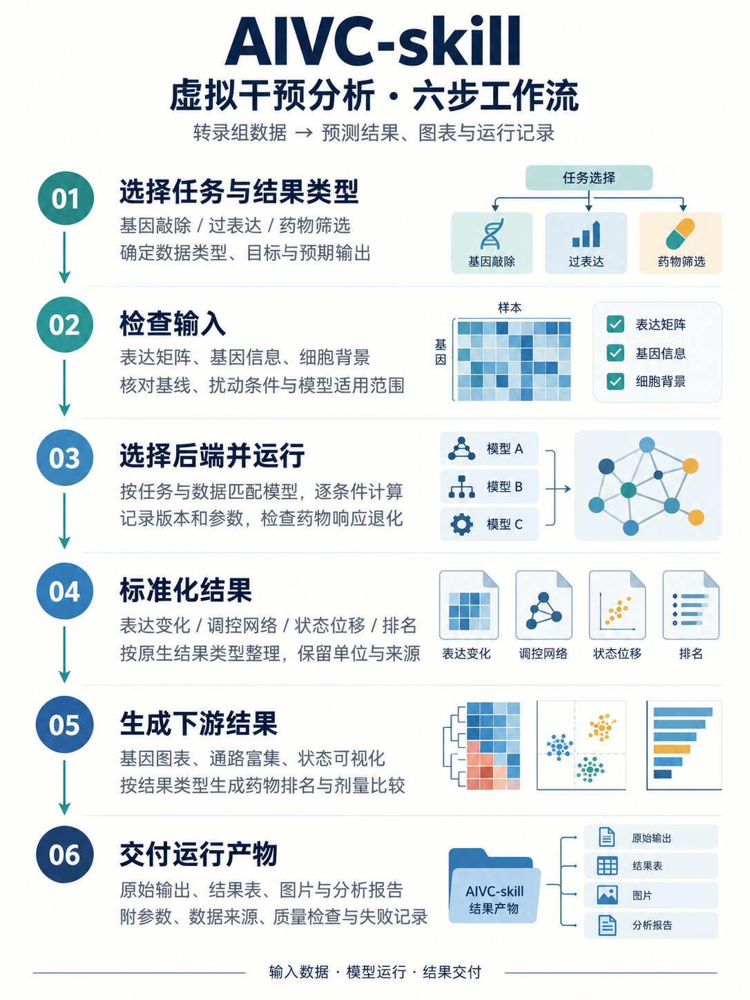

# AIVC：虚拟干预流程 Skill

用已有的 bulk / 单细胞转录组数据，跑虚拟基因敲除（KO）、虚拟基因过表达（OE）和虚拟药物筛选，把每个条件的结果、参数、质量检查和失败原因完整落盘。

Skill 完成输入检查、模型执行、结果整理和绘图，交付可复核的分析产物。



## 它解决什么问题

虚拟干预分析需要明确：

- 数据适用的模型路线及需要补充的输入；
- 数据格式、表达尺度和细胞背景与模型训练条件的匹配情况；
- 预测响应是否随干预变化，评分能否区分候选；
- 每个条件的参数、随机种子和权重版本。

AIVC 把这些问题变成流程里的固定检查项：先请用户指定分析数据、分析目录、运行环境、任务、模型和干预对象，再检查输入契约，跑完做技术对照，最后按统一目录交付。

## 任务与模型选择

| 任务 | 可选模型（运行前由用户指定） | 交付的原生结果 |
| --- | --- | --- |
| 虚拟敲除 KO | CellOracle；Geneformer `delete`；有匹配 KO/CRISPRi 训练数据时可选 GEARS | CellOracle：模拟表达差值与状态位移；Geneformer：embedding 影响；GEARS：逐基因预测响应 |
| 虚拟过表达 OE | CellOracle；Geneformer `overexpress`；有匹配 CRISPRa/OE 训练数据时可选 GEARS | CellOracle：模拟表达差值与状态位移；Geneformer：embedding 影响；GEARS：逐基因预测响应 |
| 虚拟药筛 | PRnet、chemCPA、UniPert-G2CP、UniCure、DrugReflector，按输入兼容性列出 | 后端实际支持的逐药响应或原生排名 |

CellOracle 与 Geneformer 是独立的 KO/OE 路线。CellOracle 需要单细胞表达与 GRN 先验，模拟 `delta_X` 和细胞状态位移；Geneformer 需要与权重版本匹配的原始计数和基因 tokenizer，用排序编码扰动评估 embedding 影响。Geneformer 的 `delete` 是移除基因 token 的虚拟扰动，`overexpress` 是调整 token 排序，输出 embedding 影响。运行前检查用户所选模型与数据的兼容性。

当前 Geneformer 参数化示例限人类原始全转录组 scRNA 数据，按官方格式提供 Ensembl ID 与每细胞原始计数；可执行 `delete`/`overexpress`；`inhibit`/`activate` 当前尚不可运行。CellOracle 示例读取用户选定的数据和按规则配置的匹配 base GRN。

模型路由要点：

- 药筛先分清后端**接不接受用户自己的基线矩阵**。PRnet、chemCPA 的接口可接外部基线，但具体权重仍需核对基因空间、预处理和训练域，患者样本路线按 OOD 探索记录；不接受外部基线的（UniPert-G2CP）只能用其自带细胞系的对照。
- 药筛分别检查**预测合法性、响应差异、评分区分度**。无效条件记 `failed`；评分不可区分记 `ranking_status: unresolved`，保留有效预测，停止候选推荐。
- CellOracle 使用 `estimate_transition_prob(calculate_randomized=True)` 生成随机化表达变化的投影对照：打乱 `delta_X` 并随机翻转符号，得到 `delta_embedding_random`，GRN 保持固定。空扰动的表达差值和位移均为 0。
- ORBIT 用于 pathway/program 分析；BulkFormer 不作为化合物扰动后端；不使用 scTenifoldKnk。

## 安装

Skill 包含触发与调用规则、完整流程和示例代码。执行者按 [模型资源与执行入口](references/model-setup.md) 在运行时获取并配置模型资源。把仓库放到 skills 目录即可：

```bash
git clone https://github.com/Pengzhi-Gao/aivc-skill.git ~/.workbuddy-ai/skills/aivc
```

各后端的解释器、权重路径和安装障碍见 [`references/backend-environments.md`](references/backend-environments.md)。不同后端使用隔离环境，例如 CellOracle 锁定 `numpy==1.26.4` / `pandas<=1.5.3`，装不进带新版 scanpy 的主环境。

Windows 上从零搭 CellOracle 的完整步骤（无 C 编译器时用 `ziglang` 自带 zig、用 Cython 3 重新生成 `speedboosted.c`）见 [`docs/environment-celloracle-windows.md`](docs/environment-celloracle-windows.md)。

## 使用

Skill 按 `SKILL.md` 的六步工作流执行：完成启动问答 → 检查输入 → 运行所选后端 → 标准化结果 → 生成下游结果 → 交付产物。第一次回复先核对以下设置，把缺项合并提问；当前任务已经明确的内容直接沿用：

```text
分析数据：文件完整路径；多个文件请说明各自用途
分析目录：工作文件和结果保存位置
运行环境：现有环境/解释器路径；需新建时指定安装位置
分析任务：虚拟敲除 / 虚拟过表达 / 虚拟药物筛选
使用模型：KO/OE 选择 CellOracle 或 Geneformer；药筛从兼容后端中选择
干预对象：KO/OE 填目标基因；药筛填药物库路径或候选药物清单
```

模型选项及输出差异见上方表格；GEARS 仅在有匹配扰动训练数据时提供。固定背景模型需明确选择其自带基线与细胞系，疾病参照另列。多个基因需说明逐个还是联合运行；CellOracle OE 需指定目标值或分位数。六项及模型必需输入齐全后回显设置并继续执行，无需再重复确认启动。

只给出测试目录和环境时，仍需询问数据、任务、模型及干预对象。缺项时只检查文件元数据和环境，不启动模型；不默认使用示例基因或历史药物库。模型不兼容或运行失败时，说明缺口并让用户补数据或重选，不自动切换模型。

KO/OE 参数化示例入口与输出定义见 [`examples/ko_oe/README.md`](examples/ko_oe/README.md)。运行时另行准备第三方模型、权重或 GRN 先验，完成状态按实际运行记录登记。

一次运行在用户指定的分析目录下对应一个独立结果目录：

```text
<analysis_dir>/results/<run_id>/
  manifest.json        # 六项启动设置、实际解释器、后端版本、输入哈希、参数、随机种子
  validation.json      # 覆盖检查、退化检查、对照结果、独立验证状态
  errors.jsonl         # 逐条件失败记录
  raw/                 # 后端原始输出
  tables/              # 标准化表
  figures/             # 图与 figure_manifest.csv
  report.md            # 运行事实、数值现象、质量检查与验证状态
```

## 结果展示

执行时按实际数据生成互补图组，用户也可以指定只画某张图：

- **虚拟敲除**：CellOracle 有 `delta_X` 时，生成有方向的基因响应图、响应热图和适用的通路富集；有状态位移时补充细胞群背景、随机化对照与位移分布。Geneformer `delete` 按 embedding 影响生成距离分布或候选排名。
- **虚拟过表达**：CellOracle 有逐基因结果时，生成响应图、热图和适用的富集，加目标表达设定展示；有明确目标状态时增加状态接近程度，有匹配敲除结果时作 KO/OE 并排比较。Geneformer `overexpress` 展示 embedding 影响。
- **虚拟药筛**：先给出全部药物的预测疾病方向恢复状态（有恢复方向、未见恢复方向、随剂量或条件而异、无法判定），再列出每个药物每个可用条件影响最大的 Top 30 基因及上/下调方向。另交付逐条件分数、有效候选排名、评分分布、药物响应热图和退化检查；按数据补充疾病逆转、跨细胞背景评分热图与剂量比较。逆转分数是描述性相对量，须先核对基因空间、表达平台和实验条件。Top 30 基因需要逐基因响应，排名后端展示分数、名次和覆盖情况。
- **实测验证**：有匹配真实扰动数据时，展示预测对实测散点图、基因表达对照和方向/误差评价；与纯预测图分开。

每张图保存对应数值表、绘图参数和生成状态。没有合适数据时记录跳过原因。p 值和误差条需有相应检验或重复数据；存活率和 IC50 需有实验数据。详细生成条件、坐标定义、展示检查和文献示例见 [`references/downstream-results.md`](references/downstream-results.md)。

图形完成状态以实际保存的文件为准，历史示例与新增图组分别登记。

## 结果状态

运行结果与独立验证分别记录：

| 状态 | 含义 |
| --- | --- |
| `result_available` | 后端正常输出结果 |
| `validation_status: unvalidated` | 结果已生成，但缺少独立实验/留出验证；不覆盖预测状态 |
| `partial` | 部分条件完成 |
| `no_prediction` | 目标不在后端覆盖范围 |
| `failed` | 运行失败并保留错误 |
| `not_applicable` | 输入或任务不适用 |

## 历史运行示例：非小细胞肺癌

`examples/lung_cancer/` 保存了肺癌数据上的历史运行记录。下列数字为当时计算的历史结果，适用当时的缺测、评分与质量规则。修正规则后的运行另行记录。勘误见示例报告。

| 分支 | 数据 | 后端 | 结果 |
| --- | --- | --- | --- |
| 疾病参照 | GSE81089（NSCLC bulk RNA-seq，199 肿瘤 / 19 正常） | Welch t 检验 + BH | 2131 个差异基因，978 landmark 基因覆盖 96.3% |
| 虚拟 KO/OE | GSE198291（LUAD scRNA，QC 后 703 细胞） | CellOracle 0.20.0 | STAT3、JUN 各跑 KO 与 OE，原始投影与随机化投影的向量差长度 0.49–0.70；不能解释为特异信号 |
| 虚拟药筛（LINCS 背景） | A549 子集，458 药 / 2367 条件 | PRnet | 逆转分数 −0.137 ~ +0.227，预测与实测逐条件相关均值 0.705 |
| 虚拟药筛（用户基线） | GSE198291 + 2333 个 FDA 已上市药物 × 3 剂量 | chemCPA / PRnet / UniPert-G2CP | 旧规则下 UniPert-G2CP 通过检查；其基线为内置 A549，历史全量响应未保存，需重新核验 |

历史运行暴露了外部基线适配和评分诊断问题。旧检查混淆了余弦相似性、响应差异和评分区分度，当前版本分别记录这些诊断量与运行状态。三个药筛分支的全量响应未落盘，且 UniPert 的 Top 20 响应表选错药物，补全候选热图需要重新取得全量响应。详细数据见 [`examples/lung_cancer/reports/`](examples/lung_cancer/reports/)，结果图在 [`examples/lung_cancer/figures/`](examples/lung_cancer/figures/)。

## 参考文档

| 文件 | 内容 |
| --- | --- |
| `references/input-contracts.md` | 输入字段、缺口处理、疾病参照的构造要求 |
| `references/model-capabilities.md` | 各后端的实际能力、限制和路由依据 |
| [references/model-setup.md](references/model-setup.md) | 八条模型路线的官方资源、输入转换、执行与结果入口；历史脚本的路径适配步骤 |
| [references/gears-workflow.md](references/gears-workflow.md) | GEARS 扰动数据训练/加载与表达预测示例 |
| [references/unicure-workflow.md](references/unicure-workflow.md) | UniCure 表征生成、剂量处理、预测代码和药筛结果接入 |
| [references/drugreflector-workflow.md](references/drugreflector-workflow.md) | DrugReflector 签名构造、模型调用及排名结果示例 |
| `references/backend-environments.md` | 解释器、权重、先验、已知安装障碍、调用要点 |
| `references/downstream-results.md` | 三类任务的默认图组、条件扩展、统计口径、图形源表与展示验收 |
| `references/execution-playbook.md` | 四阶段执行、结果目录、错误处理和交付格式 |
| `examples/ko_oe/README.md` | CellOracle、Geneformer 独立示例的输入、调用与结果边界 |

## 结果解读与适用条件

- 缺少独立实验或留出数据验证时标 `unvalidated`，同时交付已完成的模型结果。
- 缺关键输入时列出缺口，补齐后运行；缺失值与实测零值分别记录。
- 训练/下载公开权重前核对版本、许可证、输入物种和细胞背景。
- 分子对接在用户选定药物并确认候选蛋白后启动，交付构象、分数和阳性对照。

Geneformer 的 embedding 影响、CellOracle 的模型表达变化和药物恢复方向各有独立定义。恢复方向描述预测转录响应；临床疗效、因果关系与靶点确证需要相应实验或临床证据，科学解释由用户结合这些证据完成。

## 维护与验证

运行 `python -m unittest discover -s tests -v` 检查反例与数据索引，运行 `python scripts/package_skill.py` 生成 `dist/aivc.zip`。包内 `package_manifest.json` 保存逐文件 SHA256，脚本验证压缩包与源文件一致。

历史产物勘误见 [修复说明](docs/audit-remediation.md)。模型验证状态按对应运行记录登记。

## 许可

MIT，见 [LICENSE](LICENSE)。
