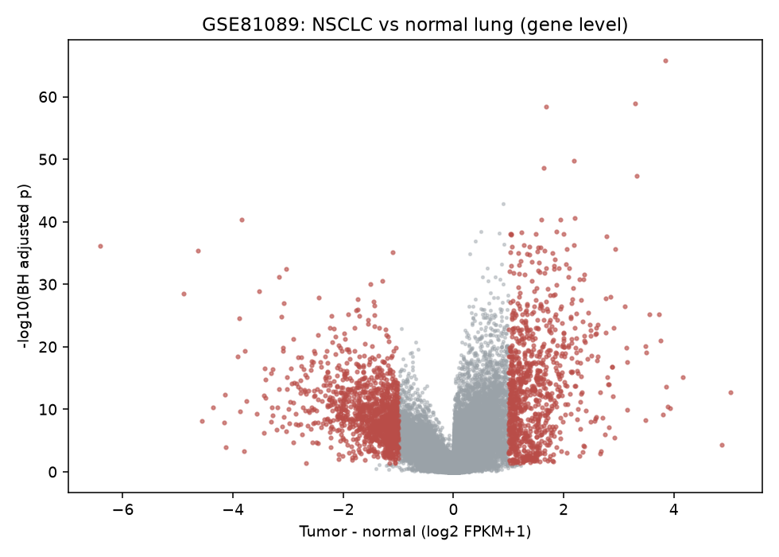
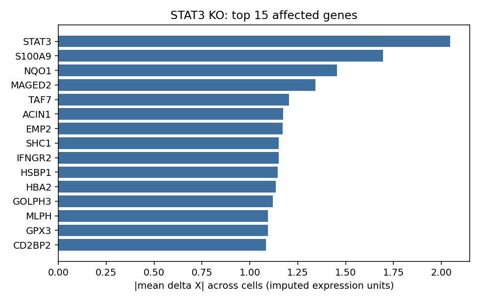
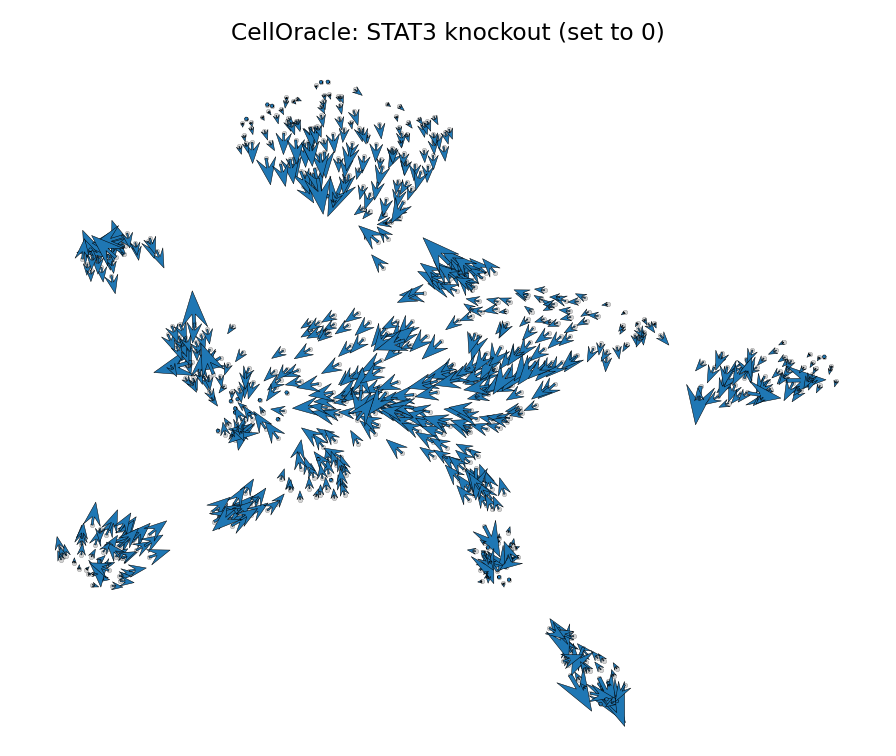
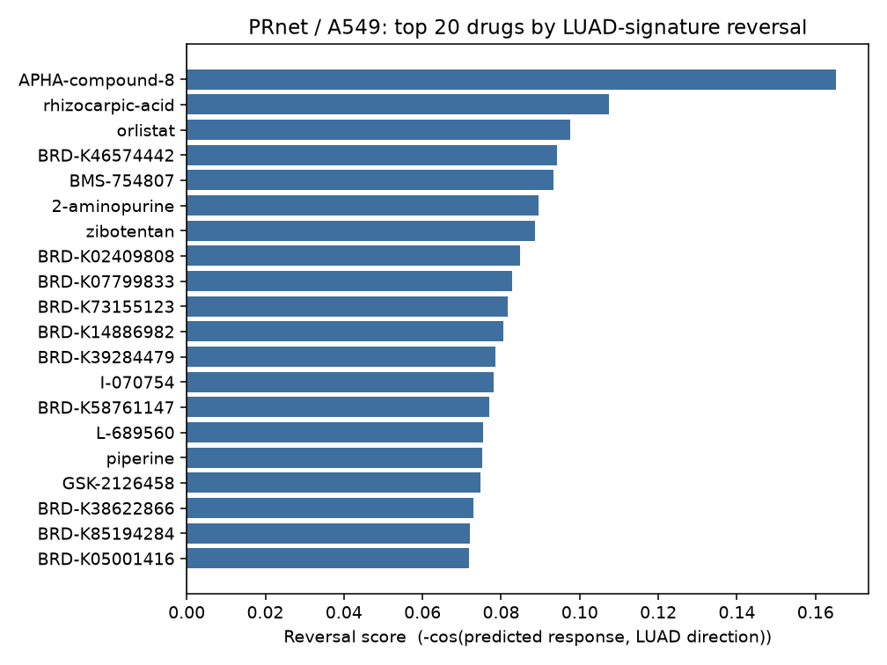
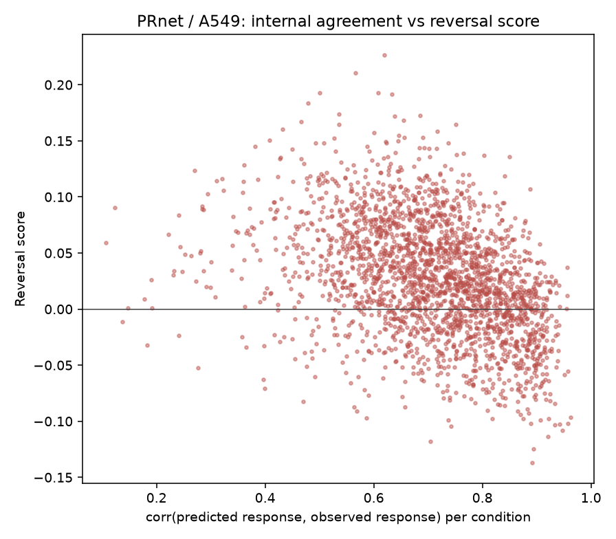
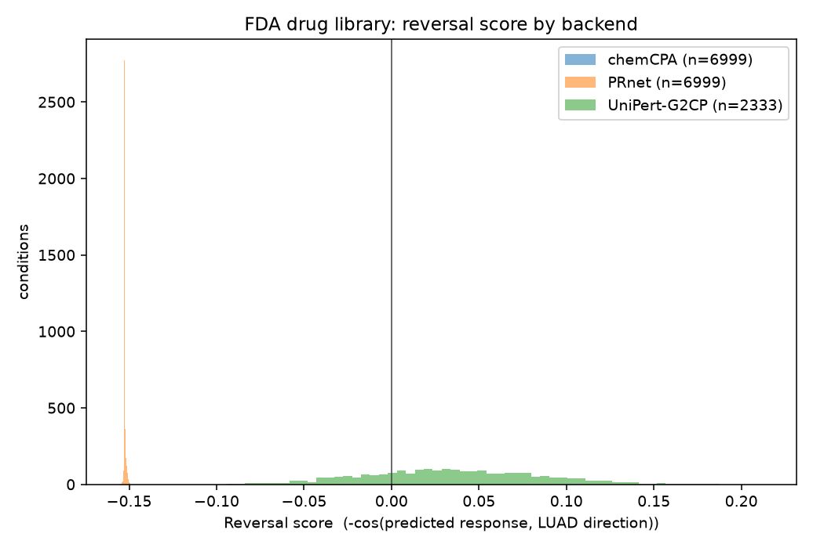
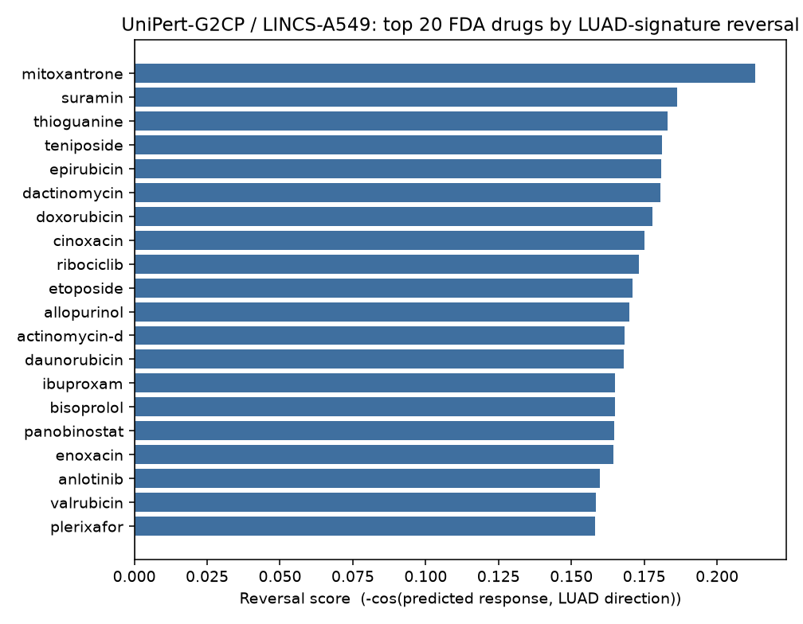

# AIVC-skill 肺癌数据端到端测试报告

> 2026-10-10 审查勘误：本文数值与图片保留为历史记录，未按修正规则重跑。旧药筛退化判据、缺测补零及 CellOracle 对照解释已修正。UniPert 的历史 Top 20 基因响应表实际取的是输入前 20 项，与排名前 20 重合为 0；三后端缺少全量响应，不能据此补全候选热图或重新验证排名。详见 `../../../docs/audit-remediation.md`。

## 目录

1. 测试范围与运行环境
2. 数据准备
3. 虚拟敲除与过表达
4. 虚拟药筛
5. 安装环节的障碍
6. 测试中修正的 skill 设计
7. 验证状态与适用范围

## 测试范围与运行环境

这一轮测试覆盖 skill 的三条路线：疾病参照的构造、虚拟敲除与过表达、虚拟药物筛选。癌种按肺癌选，数据全部从 GEO 自行下载。本机 32G 内存、8G 显存，三个分支都没有用满显存。

两个后端跑在两个隔离的解释器里。PRnet、chemCPA 和 bulk 数据处理用主环境（Python 3.13，已装 scanpy、torch）；CellOracle 用单独建的 Python 3.10 环境，因为 celloracle 0.20.0 锁定 numpy 1.26.4、pandas ≤1.5.3，和主环境装不到一起。

复现脚本在 `examples/lung_cancer/`，每个脚本头部写明了它对应 skill 的哪一步。

## 数据准备

bulk 侧最初选的是 GSE10072，58 例肿瘤对 49 例正常。这份数据能跑出差异表达，但探针是 Affymetrix HG-U133A，要接到模型的基因空间必须先拿到 GPL96 平台注释，而 GEO FTP 上这个平台的注释文件取不到。最后换成 **GSE81089**，NSCLC bulk RNA-seq，本身就是基因层面，省掉探针映射这一步。

GSE81089 有 218 个样本，按样本特征拆出 199 例肿瘤、19 例正常。矩阵里有两列带测序批次后缀（`L608T_2122`、`L771T_1`），按基础名归并；1 个基因含缺失值直接丢弃；cufflinks 用 -1 表示无法计算 FPKM，1124 个这样的值按未表达处理置 0。

对 63129 个基因做肿瘤对正常的 Welch t 检验加 BH 校正，得到 **2131 个差异基因**（FDR<0.05 且 |log2FC|>1）。再把结果投到 PRnet 的 978 个 landmark 基因空间上，覆盖 942 个，占 96.3%，其余 36 个在方向向量里记 0 并在运行记录里标注。

单细胞侧用 **GSE198291**，LUAD 单细胞计数。原始 720 细胞，按每细胞至少 200 基因过滤后剩 703 个，22335 个基因。这份数据的 GEO 矩阵里没有细胞类型注释，`source_name` 有 24 个重复，改用矩阵列名做主键。组织来源标签有 9 类，后面当分组用。目标基因 STAT3 和 JUN 分别出现在 510 和 561 个细胞里。

## 虚拟敲除与过表达

KO 和 OE 走 CellOracle 0.20.0。基因集取 1502 个高变基因，STAT3 和 JUN 强制保留。base GRN 用官方预构建的人类 promoter 版本，37003 行、1094 个 TF、27150 个靶基因。网络推断用 bagging ridge、20 次 bagging，过滤后保留 1000 条调控边。

**CellOracle 的空扰动位移为零。**`simulate_shift` 传播的是"设定值减实测值"这个差值，扰动条件为空时差值恒为 0，位移自然也是 0。技术对照使用 `estimate_transition_prob` 对 `delta_X` 打乱并随机翻转符号产生的投影，GRN 保持固定。

四个条件全部正常出结果：

| 条件 | 设定值 | 目标基因平均变化 | 位移幅度 | 随机对照 | 向量差长度 |
| --- | --- | --- | --- | --- | --- |
| STAT3 敲除 | 0 | −2.045 | 0.546 | 0.277 | 0.494 |
| STAT3 过表达 | 4.479 | +2.434 | 0.798 | 0.289 | 0.697 |
| JUN 敲除 | 0 | −2.584 | 0.581 | 0.290 | 0.518 |
| JUN 过表达 | 4.836 | +2.252 | 0.718 | 0.296 | 0.645 |

过表达的设定值取该基因 imputed 表达的 95 分位，仍在 CellOracle 的取值安全范围内。表中最后一列为两组投影的向量差长度，用于描述投影差异。原先将其解释为去噪后特异信号的结论已撤回。

基因响应排序显示：STAT3 敲除后变化最大的是 STAT3 本身，随后是 S100A9、NQO1、MAGED2、TAF7、ACIN1；JUN 敲除后是 JUN、CCL3、RPN1、NR4A1、FN1，STAT3 也排在受影响基因里。

## 虚拟药筛

药筛跑了两轮，输入口径不同，结果差别很大。

第一轮用 PRnet 在它自己的训练域内跑。本轮使用 PRnet 的 LINCS 适配器，输入来自模型自带 AnnData，按细胞系取子集；模型接口本身也接受外部对照表达，但其权重的跨背景泛化需另行验证。取 A549（人肺腺癌），4060 个 profile，其中 2367 个是加药条件，覆盖 458 种药物。取子集时要把 `paired_control_index` 指向的对照一起留下，否则数据集构建直接报错。

预测响应取"预测表达减去配对对照"，再和 GSE81089 得到的疾病方向向量算夹角，逆转分数定义为负余弦，940 个有方向的 landmark 基因参与计算，分数范围 −0.137 到 +0.227。排在最前的是 APHA-compound-8（0.165）、rhizocarpic-acid（0.107）、orlistat（0.097）。模型质量方面，LINCS 里这些条件是有实测值的，预测响应和实测响应逐条件相关，**均值 0.705、中位数 0.718**。该指标记录模型在训练域内的内部一致性。

第二轮按"用户的单细胞矩阵 + 一个药物库"的输入形态重做。药物库取自 Broad Institute 的药物重定位库，筛 `clinical_phase == "Launched"`，去掉没有可用结构的、按分子去重后入库 2333 个药物，每个药跑 0.1 / 1 / 10 µM 三个浓度，共 6999 个条件。三个后端一起跑。

按当时判据记录的历史状态如下，当前规则验收另行记录：

| 后端 | 分数极差 | 响应两两相关中位数 | 状态 |
| --- | --- | --- | --- |
| chemCPA | 3.4e-06 | 1.00000 | 退化 |
| PRnet | 0.0084 | 0.99994 | 退化 |
| UniPert-G2CP | 0.307 | 0.958 | 可用 |

判据的参考量级来自第一轮：PRnet 在 LINCS 自带 A549 对照上跑出来的正常结果是分数极差 0.363、响应两两相关中位数 0.042。对比之下，这一轮 chemCPA 和 PRnet 的响应几乎不随药物变化，chemCPA 甚至出现了 6999 个条件只有 16 种不同的响应，剂量也完全不起作用。

历史 UniPert-G2CP 评分前十名包括米托蒽醌、苏拉明、硫鸟嘌呤等。旧表保留作追溯，需按修正后的源数据与评分规则复核。

退化的原因能定位到具体环节。chemCPA 的剂量响应模块是一个带 BatchNorm 的 MLP，输出经 sigmoid 后只有 5e-4 量级，而 `combo_embedding = transformed × sigmoid`，药物对隐变量的贡献被压到 0.01 左右。使用模型自带的 A549 对照细胞与官方 `compute_prediction` 复算，5 个不同药物的响应两两相关 1.000000。**复算结果表明，该权重在当前环境下的药物效应接近 0。** PRnet 的情况不同，它在自带对照上正常，问题出在把用户矩阵当基线后，响应被一个与药物无关的共同成分主导。

这条经验写进了 skill：外部基线适配需在交付前检查预测有限性、响应变化和评分区分度。

## 安装环节的障碍

CellOracle 的依赖链在 Windows 上装不下来，这是花时间最多的地方。

`velocyto` 只有源码包，conda-forge 和 bioconda 都没有 win-64 构建。它唯一的 Cython 模块 `speedboosted` 提供 CellOracle 计算路径要用的 `colDeltaCor` 系列函数，需要编译对应扩展。本机没有 MSVC、gcc、clang，最后用 pip 包 `ziglang` 自带的 zig 当 C 编译器。这里还有一个坑：源码包里自带的 `speedboosted.c` 是旧版 Cython 生成的，在 Python 3.10 下直接报 `expression is not assignable` 和 `tp_print` 不存在，必须先用 Cython 3 从官方 `.pyx` 重新生成 C。编译出来的 `_colDeltaCor` 和 numpy 手写的 Pearson 参照实现比对，非对角元素最大绝对误差 1.7e-16。

`velocyto` 的 `__init__.py` 会连带导入需要 `pysam` 的计数模块，而 pysam 没有可用的 Windows 轮子，改成只导入 CellOracle 用到的三个子模块。`gimmemotifs` 和 `pybedtools` 只在从基因组序列扫 base GRN 的那条路径上被需要，本流程直接加载官方预构建的 base GRN，用占位模块满足导入。

这三项适配处理了编译、导入与可选依赖；CellOracle 计算使用官方源码和官方先验。完整步骤见 `docs/environment-celloracle-windows.md`。

## 测试中修正的 skill 设计

1. 原来只写了"用工作区里已准备好的 PRnet 或 UniCure"，没有写清哪个后端跑在哪个解释器、权重和先验在哪、装不上时怎么处理。新增 `references/backend-environments.md` 记录实测结论。
2. 药筛的输入形态描述不准，容易让人以为可以喂任意表达矩阵。已改成明确说明入口是模型自带的 LINCS AnnData，并要求运行前先检查目标细胞系和药物是否被覆盖。
3. 没写 CellOracle 没有未扰动基线。已补进 `references/model-capabilities.md` 和 `references/downstream-results.md`，要求位移结果同时记录固定 GRN 下的随机化表达变化投影对照。
4. 疾病方向比较缺打分口径。已补上负余弦这个常用打分，并要求同时报告全基因空间和显著基因子空间两个口径。
5. 药筛缺退化检查。已补上分数极差和响应两两相关中位数两个指标、参考量级，以及旧版“退化标 failed”的处理规则；本次已替换为预测、响应、评分三类独立状态。
6. OE 的尺度说明不够显眼。CellOracle 过表达目标值采用 imputed 表达尺度，运行记录和 `validation.json` 均保存这一单位。

## 验证状态与适用范围

- 三个分支的结果都没有独立实验或留出数据验证，全部标 `unvalidated`。药筛那个 0.705 的相关系数是模型训练域内的内部一致性。
- 药筛背景为 A549 细胞系，临床疗效需另有患者与临床证据。
- GSE198291 缺少细胞类型注释及 KO/CRISPR 扰动标签，本次按组织来源分组，最小组为 16 个细胞。训练扰动模型需另有干预标签。
- 过表达设定值来自 imputed 表达分位数，实验表达水平需另行校准。
- UniPert-G2CP 的基线为模型自带 A549 对照；`new_predict` 每次随机抽 300 个对照细胞且没有种子接口，A549 的对照只有 9 个细胞，实际是重复抽样，多次运行结果会有差异。
- 药物库剂量按体外筛选浓度记录，临床剂量与 Cmax 换算未评估。
- UniCure、DrugReflector、GEARS、Geneformer 这次没有运行，分子对接分支没有测试。
